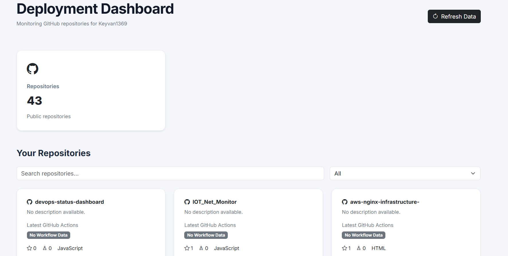
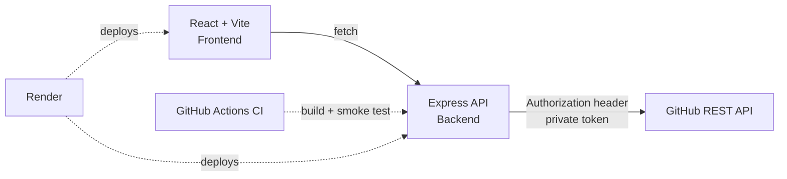

# DevOps Status Dashboard

A full-stack dashboard that monitors GitHub repositories and the status of their GitHub Actions pipelines in one place. The GitHub token lives only on the backend, so it is never exposed to the browser.

   **Live demo:** https://devops-dashboard-ui.onrender.com
   **API health check:** https://devops-dashboard-api-hje7.onrender.com/health

> The backend runs on Render's free tier, so the first request after a period of inactivity can take about a minute while the service wakes up.



---

## Features

- Lists all public repositories of a GitHub user with description, language, stars and forks
- Shows the latest GitHub Actions run status per repository (success, failure, in progress, or no workflow)
- Search and filter repositories
- Live API status indicator that polls the backend health endpoint
- Secure backend proxy: the GitHub token is never sent to the frontend
- Input validation, rate limiting, restricted CORS and security headers
- CI pipeline with GitHub Actions and infrastructure defined as code (`render.yaml`)

---

## Architecture



**Why a backend at all?** A token placed in frontend code can be read by anyone who opens the browser dev tools. The Express server holds the token, validates every request, and forwards only what the dashboard needs.

---

## Tech Stack

| Layer | Technology |
|---|---|
| Frontend | React, Vite |
| Backend | Node.js, Express, Axios |
| Security | Helmet, CORS allow-list, express-rate-limit, input validation |
| CI | GitHub Actions |
| Hosting / IaC | Render (Blueprint via `render.yaml`) |

---

## Project Structure

```
devops-status-dashboard/
├── .github/workflows/ci.yml     # Build + backend smoke test on every push
├── server/
│   ├── routes/githubRoutes.js   # API routes, validation, safe error handling
│   ├── services/githubService.js# Calls the GitHub API with the private token
│   ├── server.js                # App setup, middleware, /health endpoint
│   └── .env.example
├── src/
│   ├── components/              # UI components (cards, workflow badge, system status)
│   ├── services/githubService.js# Frontend client that calls our own API
│   ├── utils/workflowStatus.js  # Maps GitHub run status to label, icon and color
│   └── App.jsx
├── render.yaml                  # Infrastructure as code for Render
├── .env.example
└── package.json
```

---

## API Endpoints

| Method | Path | Description |
|---|---|---|
| GET | `/health` | Service health, uptime and whether a token is configured |
| GET | `/api/github/repos/:username` | List repositories of a user |
| GET | `/api/github/repos/:username/:repoName/workflows` | Latest workflow runs of a repository |

Error responses are deliberately generic (`401`, `403`, `404` or `500`). Detailed GitHub errors are only written to the server log.

---

## Environment Variables

**Backend (`server/.env`)**

| Variable | Description |
|---|---|
| `GITHUB_TOKEN` | GitHub personal access token (read-only is enough) |
| `PORT` | Server port (default `5000`, set automatically on Render) |
| `CLIENT_ORIGIN` | Exact frontend URL allowed by CORS, e.g. `http://localhost:5173` |

**Frontend (root `.env`, optional locally)**

| Variable | Description |
|---|---|
| `VITE_API_URL` | Backend URL. Defaults to `http://localhost:5000` when not set |

Copy the `.env.example` files and fill in your own values. Never commit real secrets.

---

## Run Locally

**Prerequisites:** Node.js 20+ and a GitHub token.

```bash
# 1. Clone
git clone https://github.com/Keyvan1369/devops-status-dashboard.git
cd devops-status-dashboard

# 2. Backend
cd server
cp .env.example .env        # then add your GITHUB_TOKEN
npm install
npm run dev                 # http://localhost:5000

# 3. Frontend (new terminal, from the project root)
npm install
npm run dev                 # http://localhost:5173
```

Check the backend: http://localhost:5000/health

---

## Deployment (Render)

The project ships with a Render Blueprint that creates two services:

- **API:** Node web service (`server/`) with a health check on `/health`
- **UI:** static site built with Vite, with an SPA rewrite to `index.html`

Steps:

1. Push the repository to GitHub.
2. In Render, choose **New + → Blueprint** and select this repository.
3. Enter the secret values when prompted: `GITHUB_TOKEN`, `CLIENT_ORIGIN`, `VITE_API_URL`.
4. After the first deploy, set `CLIENT_ORIGIN` to the UI URL and `VITE_API_URL` to the API URL (no trailing slash).
5. Redeploy both services. The UI must be rebuilt because `VITE_` variables are embedded at build time.

---

## CI Pipeline

On every push and pull request, GitHub Actions:

1. Installs dependencies and builds the frontend
2. Installs backend dependencies
3. Starts the server and checks that `/health` responds

---

## Security Notes

- The GitHub token exists only in backend environment variables
- `.env` files are git-ignored; only `.env.example` templates are committed
- Route parameters are validated against a strict pattern before being used in GitHub URLs
- CORS is limited to a single configured origin
- Rate limiting (100 requests per 15 minutes per IP) and Helmet security headers are enabled
- Internal error details are logged server-side and never returned to the client
- Use a fine-grained, read-only token with the minimum required permissions

---

## Roadmap

- [ ] Auto-refresh of workflow statuses
- [ ] Authentication for the API
- [ ] Support for private repositories
- [ ] Workflow run history and duration charts
- [ ] Dockerfile and container-based deployment
- [ ] Notifications for failed pipelines

---

## What I Learned

- Separating frontend and backend responsibilities to protect secrets
- Designing a small REST API with validation and safe error handling
- Configuring CORS, rate limiting and security headers
- Building a CI pipeline with GitHub Actions
- Describing infrastructure as code and deploying to a cloud platform

---

## Author

**Keyvan Hojabr** · [GitHub](https://github.com/Keyvan1369)

## License

MIT
